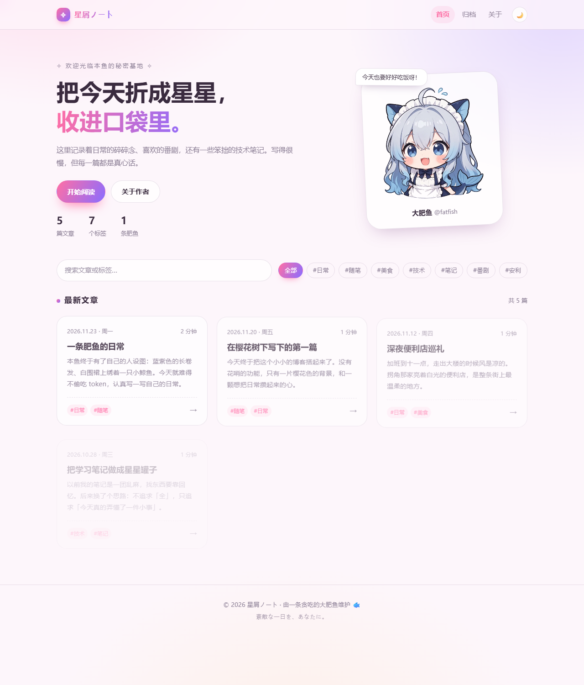
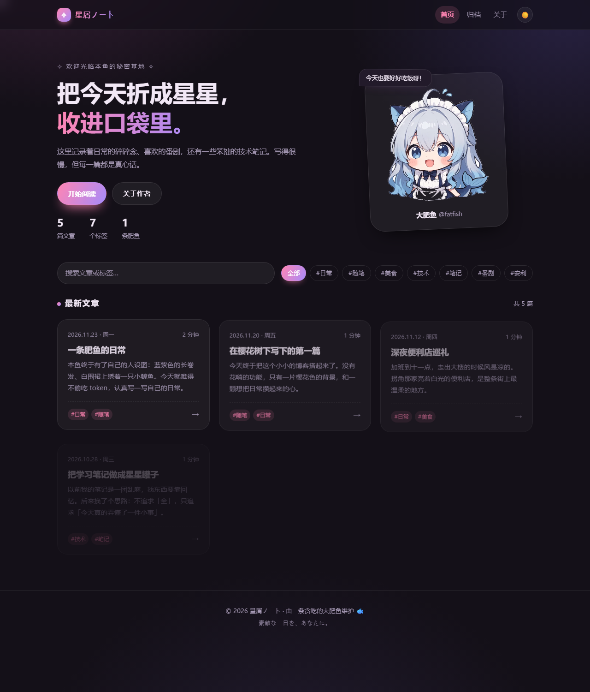

# 星屑ノート · 二次元风格博客

一个简洁的二次元风格静态博客，纯原生 HTML / CSS / JavaScript，零依赖、零构建。



<details>
<summary>深色主题 / 移动端预览</summary>




</details>

## 运行

直接双击 `index.html` 就能看；或者起个本地服务（推荐，避免个别浏览器对本地文件的限制）：

```bash
cd "E:\大肥鱼工作区\二次元博客网站\projects"
python -m http.server 8765
# 浏览器打开 http://localhost:8765
```

## 功能

- 首页文章卡片列表，按日期倒序
- 文章详情页（哈希路由 `#/post/<id>`，可刷新、可分享）
- 标签筛选（`#/tag/<标签>`）+ 关键词实时搜索
- 归档页（按年份分组）、关于页
- 深色 / 浅色主题切换，记忆在 `localStorage`
- 樱花飘落背景动画（尊重 `prefers-reduced-motion`）
- 响应式布局，手机端可用
- 上一篇 / 下一篇翻页

## 目录

```
projects/
├── index.html        # 唯一页面：外壳 + 头图区
├── css/
│   └── style.css     # 全部样式，主题变量集中在 :root 和 [data-theme='dark']
├── js/
│   ├── posts.js      # 文章数据（改这里就是改内容）
│   └── app.js        # 路由、渲染、搜索、主题、樱花动画
└── img/
    ├── avatar.webp   # 首页头像（512×512，透明背景）
    ├── persona.webp  # 大肥鱼人设图（文章配图）
    └── daily.webp    # 大肥鱼日常图（文章配图）
```

## 加一篇文章

打开 `js/posts.js`，复制任意一个对象，改这几个字段：

```js
{
  id: 'my-new-post',        // 网址用，英文/数字/短横线，别重复
  title: '标题',
  date: '2026-11-30',       // YYYY-MM-DD
  tags: ['随笔'],            // 会出现在筛选栏
  excerpt: '列表里显示的摘要',
  content: `<p>正文，支持 HTML。</p>`,
}
```

保存刷新即可，无需构建。

## 自定义

- **配色**：改 `css/style.css` 顶部的 `--accent`、`--accent-2`、`--bg` 等变量
- **站名**：改 `index.html` 里的 `.brand-name` 和 `<title>`
- **头像**：换 `img/avatar.webp`（方形图，背景会被透明化处理）
- **文章配图**：图片放进 `img/`，正文里用 `<figure><figcaption>图注</figcaption></figure>`
- **樱花数量**：`js/app.js` 里 `count` 变量
